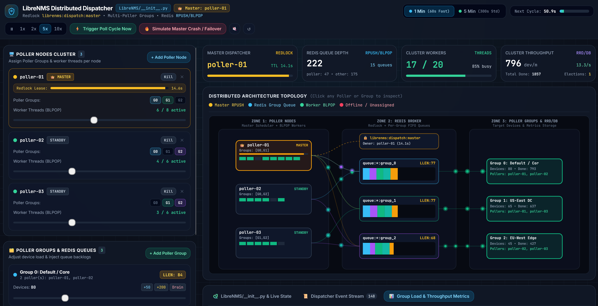

# LibreNMS Distributed Dispatcher Service Simulator

An interactive, single-page HTML5 & JavaScript visual simulator modeling the **LibreNMS Python Dispatcher Service** (`LibreNMS/__init__.py`). This tool demonstrates how a multi-node LibreNMS cluster coordinates via **Redis** and **Redlock** to schedule, route, and execute polling jobs across multiple **Poller Groups** without duplicate dispatching or job loss.



---

## Overview

In a distributed LibreNMS deployment, multiple poller nodes run the Python dispatcher service simultaneously. To prevent duplicate job scheduling while scaling worker throughput horizontally, LibreNMS separates **Master Scheduling** from **Distributed Worker Execution**:

1. **Single Master Election (`Redlock`)**: All online poller nodes compete for a distributed Redis lock (`librenms:dispatch:master`). Only the lock holder (`is_master = True`) runs periodic dispatch timers and pushes due device jobs (`RPUSH`) into Redis.
2. **Per-Group Redis Queue Namespaces**: Jobs are partitioned by `poller_group` and queue type (`librenms:queue:<type>:group_<id>`), ensuring devices in isolated networks or regional data centers are only polled by authorized nodes.
3. **Concurrent Worker Pools (`BLPOP`)**: Every online poller node—both Master and Standby—runs a local pool of worker threads that issue blocking `BLPOP` commands strictly against the Redis queues matching that node's subscribed `poller_groups`.

---

## Key Features

### 1. Redlock Master Election & Automatic Failover
- Models the `librenms:dispatch:master` distributed mutex with a **`15.0s` TTL** and **`5.0s` heartbeat renewal**.
- Includes a **"Simulate Master Crash / Failover"** action (or per-node **Kill / Start** buttons) to test high-availability behavior:
  - Taking the Master node offline abruptly leaves the Redlock held until its remaining TTL expires.
  - Any in-flight jobs on the crashed node's workers are preserved/re-queued in Redis (`zero job loss`).
  - Once the lock TTL reaches `0.0s`, an online Standby node automatically wins election, acquires the lock, and resumes dispatching.

### 2. Multi-Poller Nodes & Poller Groups
- **Poller Nodes Cluster**: Add or remove poller nodes (`poller-01`, `poller-02`, `poller-03`, etc.), toggle each node online/offline, assign group subscriptions (`G0`, `G1`, `G2`, ...), and adjust each node's worker thread count (`1` to `16` threads).
- **Poller Groups & Redis Queues**: Create new Poller Groups, adjust managed device counts (`10` to `250` devices), inject artificial queue backlogs (`+50` or `+200` jobs), or flush (`Drain`) queues on demand.
- **Stranded Group Detection**: If all pollers subscribed to a Poller Group are removed or taken offline, the simulator flags the group as unassigned (`0 pollers assigned`) and visualizes the resulting Redis queue buildup.

### 3. 1-Minute vs. 5-Minute Polling & Queue Types
- Switch instantaneously between **1-Minute (`60s` Fast)** and **5-Minute (`300s` Standard)** polling cycles, or click **"Trigger Poll Cycle Now"** to dispatch an immediate wave across all groups.
- Individually enable or disable the five LibreNMS dispatcher queue types:
  - `poller` (device metrics polling)
  - `discovery` (device/port discovery)
  - `services` (Nagios/service checks)
  - `ping` (fast ICMP reachability checks)
  - `alerting` (alert rule evaluation)
- Tune simulated SNMP/RRD execution latency (`200ms` – `3000ms`) and simulation playback speed (`Pause`, `1x`, `2x`, `5x`, `10x`).

### 4. Interactive 3-Zone HTML5 Canvas Topology
Real-time animated architecture diagram showing packet flow across three zones:
- **Zone 1 — Poller Nodes**: Displays the Master crown (`👑`), Redlock lease bar, subscribed Poller Groups, and per-thread worker LED activity indicators.
- **Zone 2 — Redis Broker**: Visualizes the `librenms:dispatch:master` lock owner/TTL alongside segmented multi-queue depth (`LLEN`) bars for every Poller Group.
- **Zone 3 — Poller Groups & RRD/DB Storage**: Shows target device groups, active consumer pollers, and storage write pulses upon job completion.
- **Click-to-Inspect**: Click any Poller Node or Poller Group directly on the canvas to open a live telemetry inspector card.

### 5. Live Code, Event Stream & Throughput Tabs
- **`LibreNMS/__init__.py` & Live State**: Annotated Python reference implementation that highlights the active execution phase (`MASTER`, `DISPATCH`, `WORKER`) in real time next to live runtime state variables.
- **Dispatcher Event Stream**: Filterable real-time log feed (`[MASTER]`, `[LOCK]`, `[DISPATCH]`, `[WORKER]`, `[FAILOVER]`) with pause and clear controls.
- **Group Load & Throughput Metrics**: Compares job completion share across Poller Nodes and tracks queue depth (`LLEN`) and average queue wait time per Poller Group.

---

## Architecture Flow

```text
+--------------------------+        RPUSH (by poller_group)        +-----------------------------------+
|   Master Poller Node     | ------------------------------------> |           Redis Broker            |
|  (Holds Redlock Lease)   |                                       |  - librenms:dispatch:master       |
+--------------------------+                                       |  - librenms:queue:*:group_0       |
                                                                   |  - librenms:queue:*:group_1       |
+--------------------------+        BLPOP (subscribed groups)      |  - librenms:queue:*:group_N       |
|  All Online Poller Nodes | <------------------------------------ +-----------------------------------+
|  (Worker Thread Pools)   |                                                         |
+--------------------------+                                                         |
             |                                                                       v
             +----------------> Execute SNMP / Service Check ------------> Write RRD & MariaDB
```

---

## Suggested Experiments

1. **Test Master Failover**: Click **Simulate Master Crash / Failover** in the top bar. Watch the amber Redlock TTL count down, observe Standby workers continuing to drain existing Redis queues uninterrupted, and see a Standby node promote itself to Master once the lock expires.
2. **Simulate Regional Backlog & Horizontal Scaling**: Inject **`+200`** jobs into `Group 1: US-East DC`, then subscribe additional poller nodes to `G1` or increase their worker sliders to watch queue depth (`LLEN`) drain rapidly.
3. **Observe an Unassigned Poller Group**: Uncheck `G2` from all poller nodes and trigger a poll cycle. Watch `queue:*:group_2` accumulate stranded jobs until a poller subscribes to `G2`.
4. **Compare 1-Min vs. 5-Min Polling Pressure**: Toggle between **1 Min (`60s`)** and **5 Min (`300s`)** while raising average poll latency to `2000ms` to see how worker saturation affects queue wait times.

---

## Running the Simulation

No build step, backend server, or external dependencies are required:

1. Open `librenms-dispatcher-simulator.html` in any modern web browser (Chrome, Firefox, Edge, or Safari).
2. *(Optional)* Internet access loads Tailwind CSS and Google Fonts (`Inter` and `JetBrains Mono`) from their CDNs.
